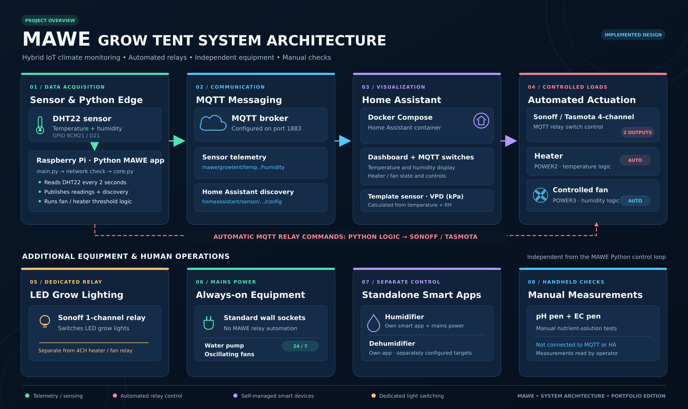

# MAWE — Smart Farm

Raspberry Pi environmental monitoring and relay-control source by Sizeka Maweya. This repository packages the supplied MAWE Python application and Home Assistant configuration examples. The original Python logic is preserved; local device identifiers and addresses have been replaced in configuration examples.



## Included implementation

- DHT22 temperature and humidity acquisition through Adafruit CircuitPython.
- MQTT telemetry and Home Assistant discovery messages.
- Sonoff/Tasmota fan and heater command functions.
- Home Assistant MQTT switch configuration and a derived VPD template.
- Docker Compose definition for Home Assistant.

The broader physical setup includes separately controlled lighting, standalone smart devices, and manual pH/EC measurements. Their appearance in the architecture does not imply corresponding Python integrations in this source.

## Files

`main.py` checks connectivity and starts `core.py`. The core loop reads the sensor, publishes readings, and invokes relay control. `sensors/`, `mqtt/`, and `hardware/` contain these integrations. `blinkatest.py` is a GPIO smoke check, not an automated test suite.

## Raspberry Pi setup

Use a Raspberry Pi with compatible GPIO hardware and a DHT22 connection matching `sensors/temp_humidity.py`. This is hardware-dependent software, not a desktop web application.

```sh
python3 -m venv .venv
source .venv/bin/activate
pip install -r requirements.txt
cp config/settings.example.yaml config/settings.yaml
```

Edit the local configuration for your broker and relay topics before running from the repository root:

```sh
python main.py
```

The `sonoff.host` field is used as the MQTT broker hostname by the relay code, despite its name. Relay publishing currently uses port 1883 with no authentication; telemetry supports the configured username/password. Credentials must remain in ignored local files.

## Home Assistant configuration

`homeassistant/docker-compose.yml` runs Home Assistant only; it does not provide an MQTT broker. Configure a broker and Home Assistant's MQTT integration separately. Copy `configuration.example.yaml` to `configuration.yaml` within `homeassistant/config`, then replace the example device topic. The supplied configuration references `automations.yaml`, `scripts.yaml`, `scenes.yaml`, and `themes/`; these were not supplied and must come from your own installation. This archive contains no dashboard definition or Home Assistant database.

Host networking in this Compose file targets the original Linux deployment. It is not a ready-made Mac hardware simulation.

## Implementation limits

This is a source snapshot of a personal hardware project. No hardware commissioning or runtime reliability test was performed when packaging it. The telemetry publisher does not wait for delivery or apply discovery retain settings. Relay state in Python tracks commands sent rather than device feedback; Home Assistant separately subscribes to relay state topics. Existing control logic has uncovered conditions and should be reviewed before connecting real loads. The connectivity check pings an external address, so it can fail even when local MQTT is reachable.

The supplied files contain no automated sensor integrations for water temperature, pH, EC, or lighting, and no history database, dashboard export, or AI model. No licence has been added on the owner's behalf.
